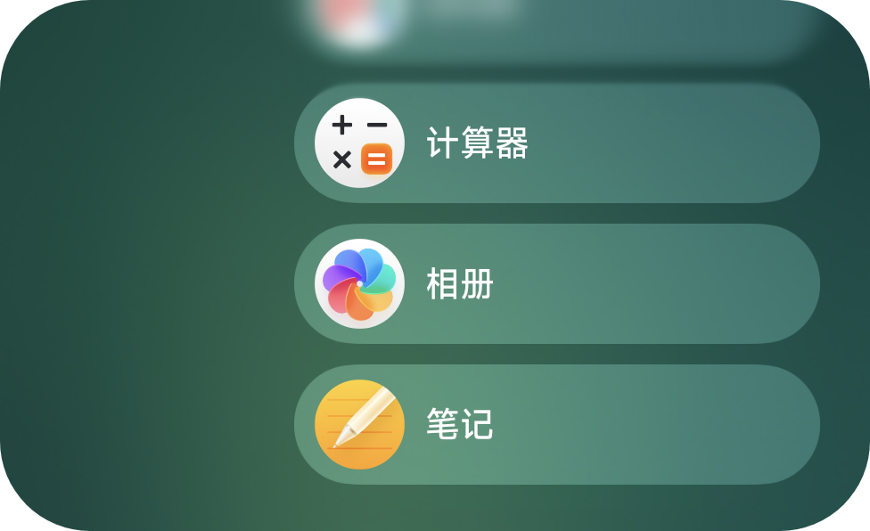
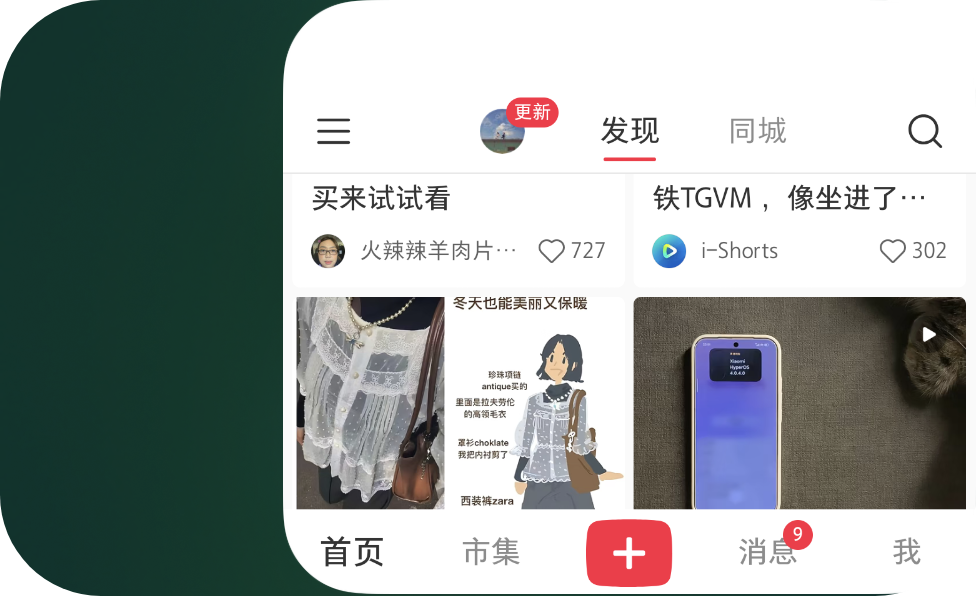
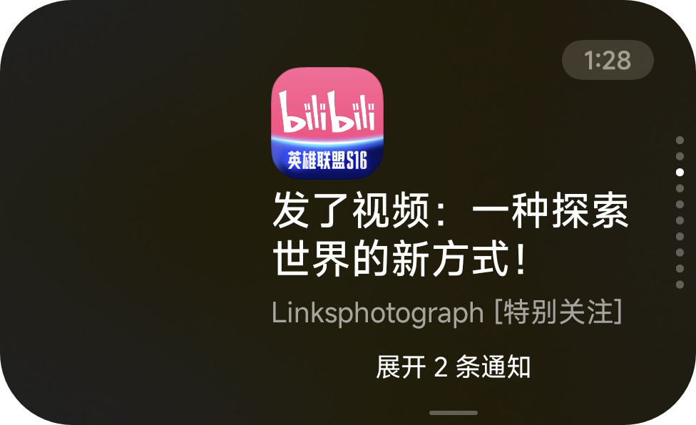
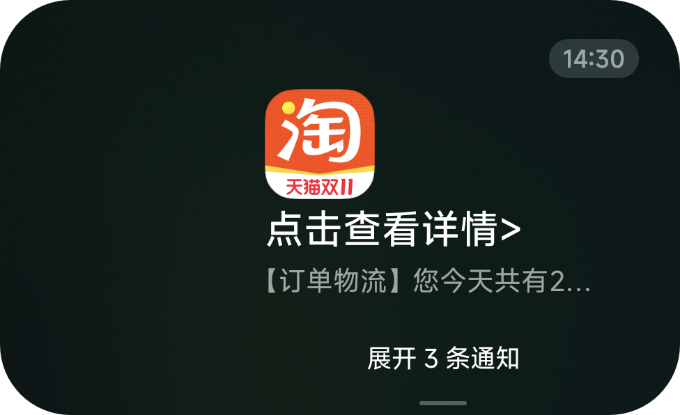
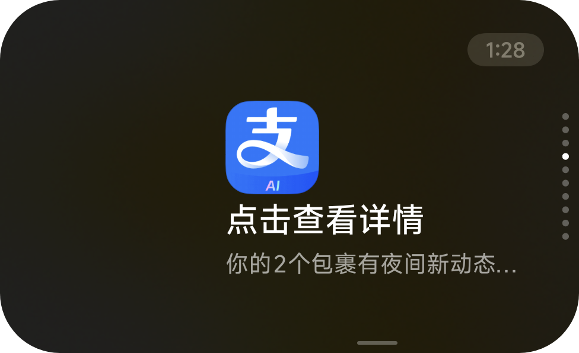
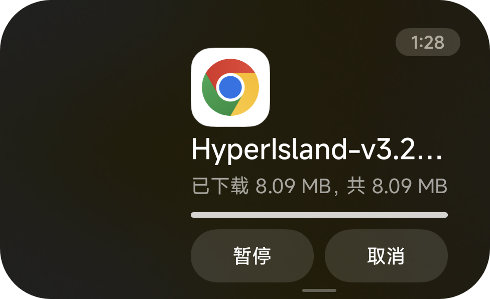
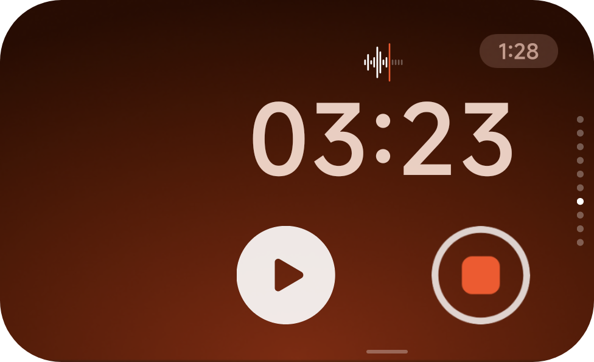
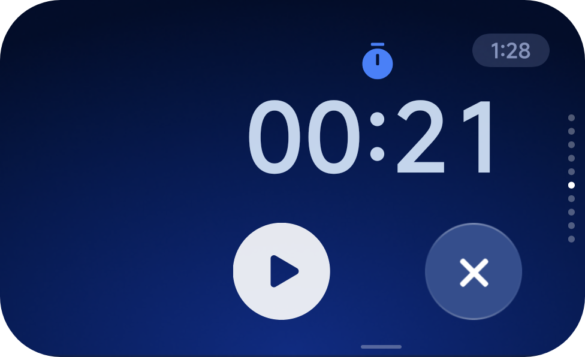

<p align="center">
  
</p>

<h1 align="center">𝒮ℯ𝒾𝓃ℯ</h1>

<p align="center">
  A rear-screen enhancement module for Xiaomi 17 Pro / 17 Pro Max, forked from <a href="https://github.com/killerprojecte/REAREye">REAREye</a>.<br>
  Built on LSPosed / Xposed, it provides finer-grained controls for the system framework, Subscreen Center, Theme Manager, and System UI.
</p>

<p align="center">
  <a href="./README.md">中文</a> · <a href="https://github.com/ziyuan-404/Seine">Project Home</a>
</p>

<p align="center">
  <a href="https://github.com/ziyuan-404/Seine/releases"></a>
  <a href="https://github.com/ziyuan-404/Seine/blob/main/LICENSE"></a>
  <a href="https://github.com/ziyuan-404/Seine/issues"></a>
  <a href="https://developer.android.com/"></a>
  <a href="https://github.com/LSPosed/LSPosed"></a>
</p>

## Feature Overview

- Allow selected apps to launch on the rear screen, with activity whitelist control.
- Manage background whitelist and process locking to improve rear-screen app residency.
- Customize the music controls whitelist for broader media app compatibility.
- Enhance lyric display with original text, translations, romanization, multiple providers, and
  lyric handling strategies.
- Manage rear widget templates, notification routes, resident cards, per-card template variables,
  and extra display options.
- Install, update, and uninstall widgets and wallpapers through Rear Store.
- Manage rear wallpapers, timed rotation, drag sorting, imports, metadata, previews, and template
  config.
- Remove Theme Manager restrictions, including video wallpaper duration, frame rate, mute, and
  template count limits.
- Remove CN-region Google Play Services restrictions.
- Provide Quick Settings tiles for moving apps between the main and rear screens, plus shortcuts for
  force-stopping target apps.

## Fork Features

This fork continues development on [REAREye](https://github.com/killerprojecte/REAREye).

**Use case** Receive notifications, read messages and send quick replies while your phone is face down.

- **Rear-screen notification cards** mirror main-screen notifications in the rear notification-card area, enhance notification security and animations, and provide buttons for quick rear-screen actions.
- **Rear app management** adds app cards, supports the stock app picker and a new honeycomb layout, and allows more apps to run on the rear screen.
- **WeChat / QQ adaptations** add dedicated rear-screen scopes to improve app launching, input and notifications, alongside the Baidu input-method scope.
- **Keyboard and interaction** support the current input method in rear-screen text fields, keep input fields clear of the keyboard, and adapt back gestures, swiping up to return Home, and launch-origin animations.
- **Interface animations** reference **STRAY洋葱**’s animation designs, used with permission.
- **Module interface** rebuilt with Mochi Compose, including a Mochi theme, predictive back, liquid menus and navigation, with settings grouped by function. [Mochi Compose](https://github.com/feice11/mochi-compose)
- **Display adjustments** bring together equivalent DPI, display bounds, corner radius, timeout and per-app compatibility, with draggable bounds, sliders and previews of the display region and corners.
- **App security** supports face verification before opening rear-screen apps.
- **Notification cards and charging** adapt notification order to rear-screen paging, filter the system’s “More notifications” entry, and add charging effects and screen-on display options.
- **Recorder and timer cards** adapt recording, stopwatch and countdown scenarios using the HyperOS 4 design language.
- **Backup and restore** support JSON files and clipboard import and export.
- **Compatibility and performance** improvements reduce repeated initialization, load app catalogs asynchronously, reuse configuration components, and control rendering through Mochi graphics quality.

## Screenshots

On-device screenshots from this fork. Click an image to view it at full size.

<table>
  <tr>
    <td width="50%" align="center">
      <p><strong>Rear app list</strong></p>
      <a href="./docs/images/rear-app-list.png"></a>
      <p>Browse and launch allowed apps on the rear screen.</p>
    </td>
    <td width="50%" align="center">
      <p><strong>Apps on the rear screen</strong></p>
      <a href="./docs/images/rear-app-xiaohongshu.png"></a>
      <p>Xiaohongshu running on the rear screen.</p>
    </td>
  </tr>
  <tr>
    <td width="50%" align="center">
      <p><strong>Notification cards</strong></p>
      <a href="./docs/images/rear-notification.png"></a>
      <p>App icons, notification content and grouped entries.</p>
    </td>
    <td width="50%" align="center">
      <p><strong>Grouped notifications</strong></p>
      <a href="./docs/images/rear-grouped-notification.png"></a>
      <p>Multiple notifications from one app grouped together.</p>
    </td>
  </tr>
  <tr>
    <td width="50%" align="center">
      <p><strong>Notification details</strong></p>
      <a href="./docs/images/rear-private-notification.png"></a>
      <p>Notification summary with a tap-to-view details entry.</p>
    </td>
    <td width="50%" align="center">
      <p><strong>Download progress</strong></p>
      <a href="./docs/images/rear-download.png"></a>
      <p>Download progress and notification actions on the rear screen.</p>
    </td>
  </tr>
  <tr>
    <td width="50%" align="center">
      <p><strong>Recorder card</strong></p>
      <a href="./docs/images/rear-recorder.png"></a>
      <p>Native recording time and controls.</p>
    </td>
    <td width="50%" align="center">
      <p><strong>Stopwatch card</strong></p>
      <a href="./docs/images/rear-stopwatch.png"></a>
      <p>Rear-screen timing and quick controls.</p>
    </td>
  </tr>
</table>

## Main Features

### System Framework Enhancements

- Rear-screen activity whitelist
    - Choose which apps may open on the rear screen.
    - Maintain a separate allowlist.
- Allow all activities on the rear screen
    - Useful when testing unsupported apps.
- Background whitelist
    - Helps selected apps stay alive while used on the rear screen.
- Locked app processes
    - Keeps selected apps alive more aggressively.
- Prevent rear screen from returning to Home after locking
    - Preserves the current rear-screen state after the screen is locked.
- Disable rear screen cover
    - Prevents the rear screen from being locked when the main screen enters fullscreen mode.

### Subscreen Center Enhancements

#### Rear Store

- Browse, search, and sort rear widgets and wallpapers.
- View widget details, README files, release notes, downloads, and repository metadata.
- Supports widget-mode and wallpaper-mode installation.
- Shows install progress, update availability, and min / max module version compatibility.
- Uninstalls store widgets and cleans their templates, cards, notification routes, or wallpaper
  records.
- Warns about install conflicts and supports uninstalling existing widgets or forcing overwrite.

#### Rear Personalization Management

- Widget Template Manager
    - Manages mappings from widgets to template files.
    - Imports template files and applies runtime mapping immediately.
    - Shows source and locked state for store-managed widgets.
- Notification Route Manager
    - Maps system notifications to rear-screen widgets by package name and notification rule.
    - Supports exact matches and regex rules.
    - Syncs card state in real time when notifications are posted or removed.
- Card Manager
    - Manages resident card title, target package, widget name, priority, and enabled state.
    - Can disable resident display while keeping the card config.
    - Supports per-card template variable config.
- Card Template Config
    - Supports text, colors, font size, alignment, images, dates, toggles, dropdowns, intents,
      background resources, animation variables, and string variables.
    - Supports light / dark previews, image previews, custom image imports, and external editor
      links.
- Widget Extra Settings Manager
    - Adds widgets that need extra display options.
    - Currently supports hiding notification timestamps for selected widgets.
- Allow focus notices on the rear screen
    - Allows notifications with valid focus / rear-screen params to pass, while still requiring the
      matching widget or template to exist.

#### Wallpaper Manager

- View available rear wallpapers, current wallpaper, and wallpaper status.
- Apply a selected wallpaper.
- Add wallpapers to a rotation schedule.
- Drag to reorder the rotation sequence.
- Configure each wallpaper interval in milliseconds.
- Enable or disable wallpaper rotation.
- Show badges for current, scheduled, unavailable, editable, third-party, and AON status.
- Import MRC / ZIP wallpaper packages.
- Select or generate preview images.
- Edit wallpaper metadata, including title, description, author, designer, category, resource
  subtype, editable state, third-party flag, and AON flag.
- Edit wallpaper template variables when supported.
- Delete wallpapers imported by REAREye or installed from the store.

#### Music Controls

- Music controls whitelist
    - Choose which apps may show music controls on the rear screen.
    - Improves support for apps using standard media controls.
- Forced music controls update
    - Fixes stale rear-screen controls for some apps after track or state changes.

#### Lyrics

- Lyric display mode
    - Supports original text, translations, and romanization.
- Lyric provider switch
    - Supports `Lyricon`.
    - Supports `SuperLyric`.
- Show artist before the first line
    - Applies to static LRC lyrics.
- Live lyric display mode
    - Choose original text or translation.
- Remove native API lyrics
    - Removes lyric metadata provided by Xiaomi's native lyric API.
- Skip title-only metadata updates
    - Avoids lyric interference when only the title changes, such as in Bluetooth metadata churn.
- Take over built-in lyric handling
    - Lets REAREye handle lyric progress and line switching, or falls back to the system logic when
      disabled.

#### Video And Media Behavior

- Force video wallpaper looping.
- Video wallpaper volume
    - Fine-grained playback volume from 0% to 100%.

### Theme Manager Enhancements

- Unlock video wallpaper restrictions
    - Removes video duration limits.
    - Removes default frame-rate limits and tries to load the source frame rate.
- Unlock rear-screen template count limit
    - Removes the original template count cap.
- Unmute video wallpapers
    - Allows adding video wallpapers with audio.
- Rear wallpaper sync
    - Keeps Theme Manager resources and Subscreen Center runtime state aligned with the wallpaper
      manager and import flow.

### Misc

- Remove CN Google Play Services restrictions
    - Used for unlocking Google service features restricted on CN firmware.
    - Examples include Timeline and Location History availability.

### Extra Features

- Quick Settings tiles
    - Move the current app to the rear screen.
    - Move a previously transferred app back to the main screen.
- Home status and quick actions
    - Shows activation status, the LSPosed version, rear-app and notification-app counts, system component versions, and update status.
    - Provides force-stop shortcuts for Subscreen Center, Theme Manager, and System UI.
- About page
    - Shows device information, project links, docs, contributors, sponsorship and references.

## Module Scope

Default scope includes these target processes:

- `android`
- `com.xiaomi.subscreencenter`
- `com.android.thememanager`
- `com.android.systemui`
- `com.miui.personalassistant`
- `com.miui.weather2`
- `com.miui.gallery`
- `com.miui.voiceassist`
- `com.baidu.input_mi`
- `com.android.soundrecorder`

## Requirements

- Android 16 / API 36 or later.
- LSPosed / Xposed compatible environment.
- A compatible framework supporting libxposed API 102.
- A target device with a rear screen. This repository mainly targets Xiaomi 17 Pro / 17 Pro Max.
- Root permission is required for some features or quick actions, such as force-stopping target apps
  and moving apps between the main and rear screens.
- Internet access is required for Rear Store, update checks, and contributor data.

## Installation

1. Download and install the latest APK
   from [Releases](https://github.com/ziyuan-404/Seine/releases).
2. Enable `Seine` in LSPosed or a compatible framework.
3. Make sure the module scope includes `android`, `com.xiaomi.subscreencenter`,
   `com.android.thememanager`, and `com.android.systemui`.
4. Reboot the device, or at least restart the relevant target apps before configuring the module.
5. Open the module app and enable the features you need.

## Usage Notes

- After changing rear-screen whitelist, music controls whitelist, widget templates, notification
  routes, cards, or wallpaper rotation, restart `com.xiaomi.subscreencenter` or use the force-stop
  shortcut on the Home page, then reopen Subscreen Center.
- Notification routing depends on the bridge between `com.android.systemui` and
  `com.xiaomi.subscreencenter`. If route changes do not apply immediately, restart both target
  processes.
- System framework changes usually require a full reboot to apply reliably.
- Theme Manager changes should be followed by restarting `com.android.thememanager`; reboot if
  needed.
- Some quick actions and system-level features require root authorization.
- Store-managed widgets, cards, and notification routes keep their source metadata. Confirm whether
  you want to uninstall or overwrite them before manual edits.
- Configure allowed rear apps under Configuration → More → Rear screen enhancements, then launch them from the rear app list.
- After unlocking the template count limit, very large template sets should still be tested for
  stability.
- If Markdown previews in store details crash, disable WebView hardware acceleration in module
  settings.

## Use Cases

- Let more apps launch or stay alive on the rear screen.
- Use rear-screen media controls with more third-party music apps.
- Control lyric sources, displayed content, and handling logic.
- Install, update, and uninstall rear widgets or wallpapers from the store.
- Maintain rear widget templates, notification routes, and resident cards yourself.
- Manage rear wallpaper rotation, sorting, imports, metadata, and previews.
- Remove original Theme Manager limits for video wallpapers and template counts.
- Handle CN Google Play Services restrictions without flashing an extra Magisk module.

## Build From Source

The project uses Kotlin, Jetpack Compose, Android Gradle Plugin, and Gradle Wrapper.

- JDK 21.
- Android SDK / Build Tools 37.
- Compile SDK 37, min SDK 36, target SDK 37.
- For release signing, configure these values in `local.properties`, Gradle properties, or
  environment variables:
    - `androidStoreFile`
    - `KEYSTORE_PASSWORD`
    - `KEY_ALIAS`
    - `KEY_PASSWORD`

Common commands:

```powershell
.\gradlew.bat assembleDebug
.\gradlew.bat assembleRelease
```

Build outputs are generated under `app/build/outputs/`. Release builds also export a renamed APK.

## Help

- Report issues: [Issues](https://github.com/ziyuan-404/Seine/issues)
- View releases: [Releases](https://github.com/ziyuan-404/Seine/releases)
- Repository: [ziyuan-404/Seine](https://github.com/ziyuan-404/Seine)

## Disclaimer

- This module modifies system and target-app behavior. Evaluate the risk yourself.
- Compatibility can vary across system versions, firmware builds, root solutions, and Xposed
  environments.
- Updates to Subscreen Center, Theme Manager, or System UI may require Hook adaptation.
- You are responsible for any functional issues, data issues, or device risks caused by using this
  module.

## License

See [LICENSE](./LICENSE).
